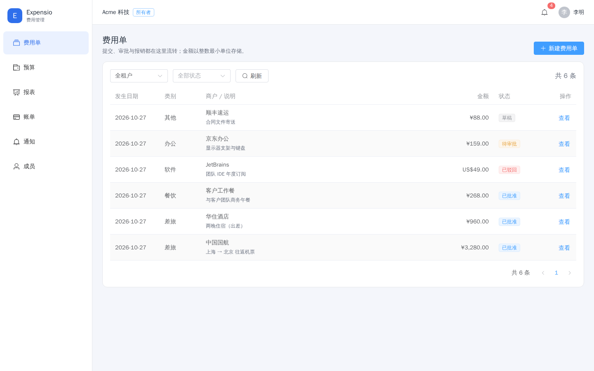
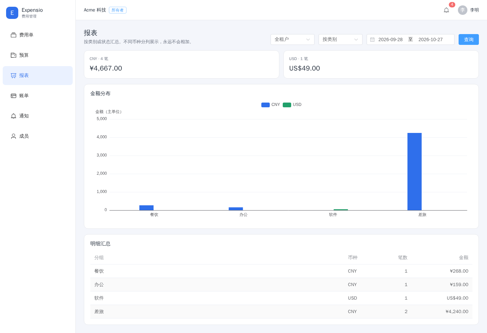
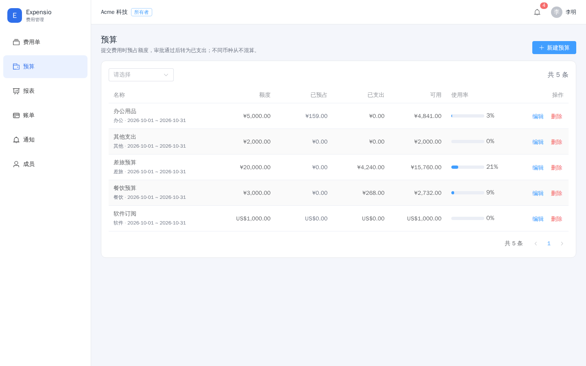
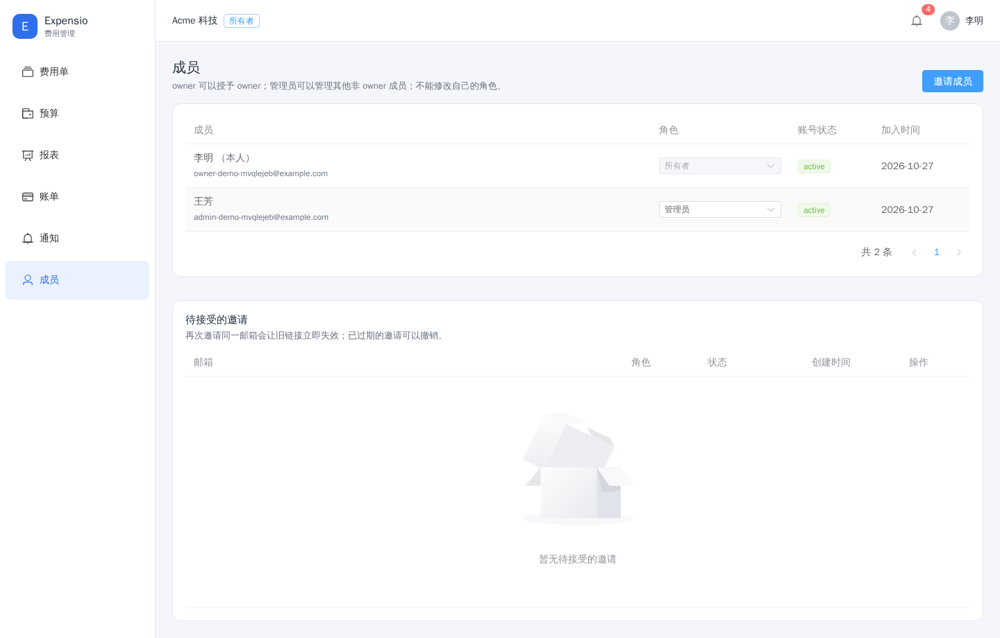

# Expensio

多租户 B2B 费用管理平台：员工提交费用单，管理员审批，预算在提交时预占、
审批通过时转为实际支出，报销完成后进入报表。后端是六个 Go 微服务，
前端是 Vue 3 管理台，异步链路走 Kafka，隔离由 PostgreSQL RLS 保证。

这个仓库的目标是"能跑起来、能验收"的完整系统，不是接口草稿：
每个服务都有迁移、健康检查、集成测试与容器镜像；`docs/PROGRESS.md`
记录每个里程碑的实际命令输出与仍未验证的风险。

## 架构

```text
浏览器
  │
  ▼
web :8086 / :5173 ──静态资源 + /api 反代──▶ gateway :8080
                                              │  JWT 校验、限流、请求 ID
      ┌───────────────┬───────────────┬───────┴───────┬────────────────┐
      ▼               ▼               ▼               ▼                ▼
 identity :8081   expense :8082   billing :8083   report :8084   notification :8085
      │               │               │               │                │
 identity_db     expense_db      billing_db      report_db      notification_db
                                      ▲               ▲                ▲
                                      └──── Kafka ────┴──── outbox ─────┘
                                         通知 / 报表读模型 / 邮件发件箱
```

| 服务 | 端口 | 数据库 | 职责 |
| --- | --- | --- | --- |
| gateway | 8080 | 无 | 统一入口、JWT 校验、路由、Redis 令牌桶限流 |
| identity | 8081 | `identity_db` | 租户、用户、成员、角色、成员邀请、登录/刷新、审计 |
| expense | 8082 | `expense_db` | 费用单、审批状态机、预算预占与扣减 |
| billing | 8083 | `billing_db` | 账单、订阅、支付回调幂等 |
| report | 8084 | `report_db` | 事件驱动的报表读模型 |
| notification | 8085 | `notification_db` | 站内通知、邮件发件箱与投递 |
| web | 8086（宿主 5173） | - | 管理台静态资源、`/api` 反代 |

技术栈：Go 1.27.3 / Gin / pgx v5 / zap / viper；PostgreSQL 16 / Redis 7 /
Kafka 3.9 KRaft / MinIO；Vue 3 / TypeScript / Vite / Element Plus / Pinia /
Vue Router / ECharts / Axios；Docker Compose、Kubernetes + Helm、
GitHub Actions、golang-migrate；testify、testcontainers-go、k6、Playwright。

## 界面预览

截图不是静态稿：`e2e/capture/preview.spec.ts` 在真实整栈上注册租户、
建预算与费用、邀请 admin 完成审批，再逐页截屏，所有数据都经真实 API 产生。
`make app-up` 之后执行 `make preview` 可重新生成到 `docs/screenshots/`。

| 费用单与状态流转 | 报表（按币种分列） |
| --- | --- |
|  |  |
| **预算占用** | **成员与邀请** |
|  |  |

登录、费用详情、账单与订阅、通知的截图在同目录。

## 关键设计

- **多租户隔离**：每个服务独占数据库，`FORCE ROW LEVEL SECURITY` +
  事务级 `app.tenant_id`；运行时账号 `NOBYPASSRLS`。`tenant_id` 只从校验过的
  JWT 提取，绝不从 body/query/path 读取。
- **金额**：`int64` 最小货币单位 + ISO-4217 币种，数据库 `bigint`；
  禁止浮点，预算检查与扣减由一条条件 UPDATE 完成。
- **事件**：事务内 outbox（不在事务里直接发 Kafka），投递器同步发送；
  消费端手动提交位点、按 `(tenant_id, consumer, event_id)` 幂等，
  永久错误进 DLQ。分区键固定为 `tenant_id`。
- **认证**：argon2id 密码；access token 为 EdDSA（Ed25519）JWT（短 TTL），
  identity 用私钥签发并公布 JWKS，其余服务只挂公钥验签；只接受 EdDSA，
  不存在共享密钥（M12 已删除迁移期 HS256 路径，见
  [ADR-0008](docs/adr/0008-token-signing-in-m6.md)）；
  refresh token 只存 SHA-256 摘要、条件轮换、重放整族撤销。
- **成员邀请**：owner/admin 生成一次性邀请链接（数据库只存 SHA-256 摘要，
  默认 7 天过期，重复邀请会撤销旧链接），接受时必须验证密码——新邮箱设置
  密码，已有账号输入原密码。邮件经 notification 发件箱投递，创建响应同时
  返回可复制的链接，见 [ADR-0010](docs/adr/0010-member-invitations.md)。
- **服务间调用**：服务间使用独立 HMAC 短时令牌，
  网关不转发 `/api/v1/internal/*`。

## 快速开始

前置：Docker Desktop（WSL2 后端）、Go 1.27.3、Node 24、GNU Make、bash。
Windows 还需 `scripts/preflight.ps1` 检查工具链；WSL/Linux 用
`./scripts/preflight.sh`。

```bash
make env       # 生成 .env：随机本地口令，权限 600，不入仓
make app-up    # 构建并启动完整栈（含迁移、建主题、管理台）
```

启动后：

- 管理台 <http://127.0.0.1:5173/> —— 直接注册新租户，第一个用户是 owner
- 网关 <http://127.0.0.1:8080/>
- Grafana <http://127.0.0.1:3000/>（`Expensio Overview`）
- Prometheus <http://127.0.0.1:9090/>、Tempo <http://127.0.0.1:3200/>
- Mailpit <http://127.0.0.1:8025/> —— 邀请/通知邮件的本地收件箱

停止：`make app-down`。只起依赖、服务用宿主进程跑：
`make up` + `make run-expense`（需要 `.env` 中的数据库配置）。

### 演示数据

```bash
export EXPENSIO_SEED_PASSWORD='<至少 10 字节的口令>'   # 只从环境变量读取
go run ./cmd/seed                                    # 默认 http://localhost:8080
```

`cmd/seed` 只调用公开 HTTP API，不直连数据库：注册 `demo-seed` 租户、邀请并
提升审批人、建四条预算、把四张费用单驱动到已报销/已批准/待审批/已驳回，
再建订阅与账单。重复执行只补齐缺失数据（第二次输出"本次新建 0"），
口令与令牌不会打印。可选参数见 `go run ./cmd/seed -h`。

## 测试

```bash
make test-integration   # EXPENSIO_REQUIRE_DOCKER=1，Docker 不可用即失败
go test ./... -race -count=5 -timeout=25m
make openapi-lint       # redocly + 契约与路由双向一致性
make load K6_DURATION=30s
```

- 集成测试用 testcontainers 启动真实 PostgreSQL 16 / Redis 7 / Kafka 3.9，
  应用代码用 `{service}_app` 连库；没有 Docker 时默认跳过，
  设置 `EXPENSIO_REQUIRE_DOCKER=1` 后跳过视为失败。
- 跨服务链路在 `internal/e2e` 单独回归：expense 写 outbox → 真实 Kafka →
  report 消费落读模型 → 报表 API 返回聚合。
- k6 对已启动整栈跑真实业务循环；M7 实测 3 VUs / 30s，
  p95 20.26–86.28ms，阈值全部通过，详见 `docs/PROGRESS.md`。
- 浏览器级 E2E：`make e2e`（Playwright 官方容器，需先 `make app-up`；
  首次运行会拉取约 1 GB 镜像）。用例覆盖路由守卫、注册建单提交、报表出图、
  access token 失效后的自动刷新，以及成员邀请全流程（创建邀请 → Mailpit
  收信 → 公开页接受 → 一次性链接失效 → 新成员登录）。

## 可观测性

六个服务与管理台统一用 OTel SDK，经 OTLP/gRPC 发往 Collector；
trace 进 Tempo，指标由 Collector 的 Prometheus exporter 暴露。
HTTP 用 W3C `traceparent`，Kafka 用记录头传播；HTTP 与 Kafka 延迟直方图
显式设置亚秒级边界。Prometheus 提供 8 条告警规则（服务缺失、5xx、P95、
Kafka、outbox、邮件、限流 fail-open、连接池）。

已知断点：outbox 只落库、不落 trace 上下文，因此
`HTTP 请求 → outbox → 投递器` 不是一条连续 trace；
`投递器 → Kafka → 消费者` 是连续的。设计取舍见
[ADR-0009](docs/adr/0009-observability-and-load-testing.md)。

## 部署

本地整栈用 `docker-compose.yml`；Kubernetes 用 `deploy/helm/expensio`，
Chart 只部署无状态服务，PostgreSQL / Redis / Kafka / Secret / Collector
由平台提供。`helm lint`、`helm template` 与 kubeconform 已通过，并在真实
k3d 集群上完成 `helm upgrade --install --wait` 与行为验收（迁移/建主题 Hook、
Ingress、NetworkPolicy、RBAC、事件链路）。Chart 另提供 HPA、cert-manager
注解与托管 Kafka 的 TLS/SASL 配置，但这些只做了渲染与单元测试；托管云集群、
ACME 签发与真实扩缩容尚未验证，见 [docs/DEPLOYMENT.md](docs/DEPLOYMENT.md)。

## 目录

```text
cmd/            六个服务与管理台的入口
internal/       各服务实现、平台库（config/log/telemetry/kafka/outbox）
migrations/     六个库的 golang-migrate 迁移
deploy/         Helm chart、本地 Prometheus/Tempo/Collector/Grafana 配置
frontend/       Vue 3 管理台（Vite 构建，产物由 internal/web 提供）
e2e/            Playwright 浏览器级测试
load/k6/        压测脚本
docs/           架构、部署、进度与 ADR
```

## 文档

- [docs/ARCHITECTURE.md](docs/ARCHITECTURE.md) —— 当前真实结构与边界
- [docs/DEPLOYMENT.md](docs/DEPLOYMENT.md) —— 本地与 Helm 部署
- [docs/PROGRESS.md](docs/PROGRESS.md) —— 里程碑验收记录与风险清单
- [docs/INTERVIEW.md](docs/INTERVIEW.md) —— 项目讲解、取舍与高频追问
- [api/openapi.yaml](api/openapi.yaml) —— HTTP 契约（与路由双向锁定）
- [docs/adr/](docs/adr/) —— 架构决策记录

## 已知限制

- 集群验收用的是 k3d（双节点 k3s）与单节点依赖；托管云（EKS/AKS/GKE）、
  ACME 证书签发、HPA 真实扩缩容、真实 SASL Kafka、PDB 驱逐演练与多可用区
  未验证。
- CI 在 GitHub runner 上全绿；main 分支额外用刚推送的镜像跑整栈
  Playwright 与真实 k3d 集群验收（PR 不跑，本地用 `make e2e`）。
- 邀请链接是 bearer 凭据：拿到链接的人可以为**新邮箱**设置密码入组；
  已有账号仍须原密码。没有域名限制、批量邀请与撤销通知。
- 公钥在线轮换已在 Compose 真实栈完成四阶段演练（加新公钥 → 切私钥 →
  移除旧公钥 → 回退）；托管集群上仍按 `docs/DEPLOYMENT.md` 的步骤执行。
- STARTTLS、证书校验与 AUTH PLAIN 已对真实第三方 SMTP 服务实测，并用 IMAP
  确认收件；生产供应商的配额、退信处理与 SPF/DKIM 仍属运维配置。
- 单地域部署，没有跨集群复制与故障转移。

这些限制与对应风险编号、处置状态都记录在
[docs/PROGRESS.md](docs/PROGRESS.md) 的风险清单里，不在 README 里含糊带过。
